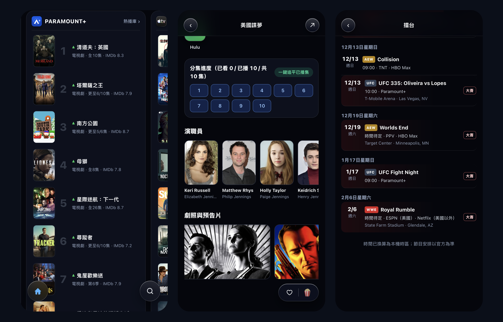

# Dramov

感谢 **Gemini 4 Carbon** 和 **Claude Opus 5.5**，让我有机会把这款追剧、追片、追擂台的轻量应用一点点打磨出来～

访问地址：

```text
https://dramov-tracker.vercel.app
```

## 一、使用说明

### 1. 添加到手机主屏幕与电脑桌面

- **iPhone / iPad**：用 Safari 打开上方网址，点击「分享」按钮，选择「添加到主屏幕」，即可获得无地址栏的全屏独立应用。
- **Mac / Windows 电脑**：Mac Safari 选择「文件 → 添加到程序坞」，Chrome 或 Edge 点击地址栏右侧的安装图标即可独立运行。

### 2. 跨端云同步与本地备份

- **GitHub 私密云同步**：在「设置」页填入勾选了 `gist` 权限的个人访问令牌（`ghp_...`），即可在手机、平板与电脑之间一键上传、下载并合并片单与追剧进度。
- **多应用共用隔离**：同一枚 Token 可与其他工具共用，Dramov 的数据独立存放在 `dramov-tracker-sync-v1.json` 中，互不干扰；「设置」页同时支持本地 `.json` 备份的导出与导入。

## 二、主要功能

- **每日热播榜**：首页按各大流媒体平台每日真实排名展示 Top 10 与升降趋势，另设热播电视剧、热播电影、港澳台与日韩专区，频道可自由排序与开关。
- **片库与全网搜索**：进入任意平台片库，可在「精选 / 最新 / 高分」间切换；搜索不限内置平台，中英文片名都能查到简介与可观看的平台。
- **擂台赛程**：可选开启「擂台」频道，WWE、AEW、UFC 的每周节目与大型赛事按所选时区显示，每 6 小时自动刷新。
- **追剧进度与三语界面**：详情页支持分集打卡、一键追平、演员表与剧照预告；支持繁體中文（默认）/ 简体中文 / English 与深浅色模式，底部液态玻璃导航栏下滑自动收缩。



## 三、更新日志

### 2026-11-22

- **v14**：搜索不限内置平台并支持自动搜索；擂台列按榜单高度铺满；海报加载卡住时自动重拉。
- **v13**：擂台赛程每 6 小时自动更新，设置新增「赛程时区」，页面底部留白收紧。
- **v12**：新增两个流媒体平台与港澳台、日韩、擂台频道，Top 10 改用每日真实排名并显示升降趋势。
- **v11**：底栏收缩动画、片库三档排序与点击修复、首页 Top 10 横排、三语界面。

### 2026-11-21

- **v10**：液态玻璃底栏重做，修复海报匹配与占位图问题，一键脚本推送 GitHub 并部署。
- **v8-v9**：首页改版为巨幅竖版新剧海报与平台 Top 10 热榜。
- **v2-v7**：接入实时热度、详情页演职员与播放来源，完成私密云同步与平台排序隐藏。
- **v1**：完成 Dramov 单页原型，支持主屏幕全屏安装与离线缓存。
